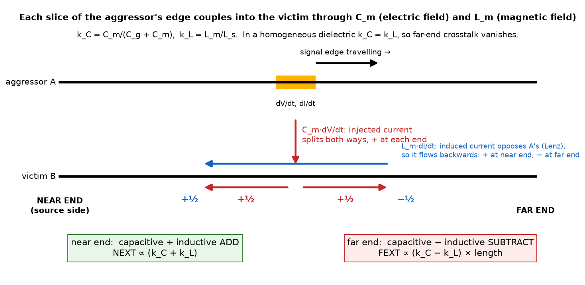
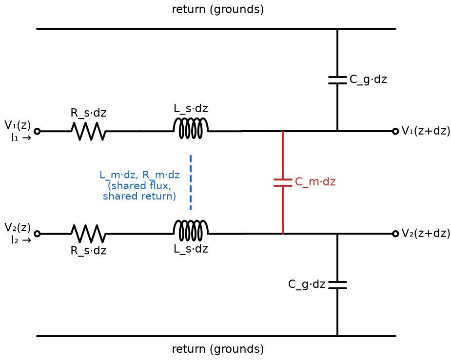

# Coupled lines, part A1–A2: where coupling comes from, and the coupled telegrapher's equations

First note of the coupled-line plan (A1–A6, then B1–B4). It builds the physical
picture of crosstalk (A1) and derives the equations that govern two coupled
lines (A2), in the same way as the single-line derivation. Modes (A3), the
solution with terminations (A4) and the predictions for the CST file (A5–A6)
come next.

Checks: `docs/coupled/check_A1A2.py` (numpy, scipy) verifies §3 and §4 to
$10^{-15}$.

## Abbreviations and symbols

| Term | Meaning |
|---|---|
| NEXT | near-end crosstalk: voltage on the victim at the end where the aggressor is driven |
| FEXT | far-end crosstalk: voltage on the victim at the opposite end |
| aggressor, victim | the driven line (A, line 1) and the undriven line (B, line 2) |
| CPW | coplanar waveguide |
| TEM | transverse electromagnetic: field entirely in the cross-section |
| KVL, KCL | Kirchhoff's voltage law (voltages around a loop sum to zero) and current law (currents into a node sum to zero) |
| $R, L, G, C$ | resistance, inductance, conductance and capacitance per unit length |
| $\mathbf{R}, \mathbf{L}, \mathbf{G}, \mathbf{C}$ | the same as $2\times2$ matrices for the pair |
| $\mathbf{Z} = \mathbf{R} + j\omega\mathbf{L}$, $\mathbf{Y} = \mathbf{G} + j\omega\mathbf{C}$ | series impedance and shunt admittance matrices per unit length |
| $k_L, k_C$ | inductive and capacitive coupling coefficients (§1.4) |

---

## 1. A1: where coupling comes from

### 1.1 One line, as a reminder

A single line carries a voltage $V$ between its signal conductor and its
return (the grounds) and a current $I$ along it. Per unit length it stores:

- **charge** $q = C\,V$: the electric field between signal and grounds;
- **magnetic flux** $\psi = L\,I$: the magnetic field around the signal,
  closed by the return current in the grounds.

These two numbers, plus the losses $R$ and $G$, are all the telegrapher's
equations need.

### 1.2 Two lines: the electric field is shared (capacitive coupling)

Put a second line next to the first. Some field lines leaving signal 1 now end
on signal 2 instead of on the grounds (top panel of
`docs/cst/xtalk/mode_fields.png`). The charge on each conductor therefore
depends on **both** voltages:

$$
q_1 = C_{11}V_1 + C_{12}V_2, \qquad q_2 = C_{21}V_1 + C_{22}V_2
\qquad\Longleftrightarrow\qquad
\mathbf{q} = \mathbf{C}\,\mathbf{V}
$$

**What the indices mean.** Index 1 is the **signal conductor of line A**
and index 2 the **signal conductor of line B**. $V_1$ and $V_2$ are their
voltages measured from the grounds. All the ground conductors (left and right
of each CPW, and any shared middle ground) are tied together and form the
common reference at 0 V. They are not entries of the matrix: their charge is
whatever balances the signals, $q_{\text{gnd}} = -(q_1 + q_2)$. So
$C_{11}$, $C_{22}$ describe each signal against the grounds, and $C_{12}$,
$C_{21}$ describe signal A against signal B.

$\mathbf{C}$ is the **Maxwell capacitance matrix**. It is what a field solver
returns, but its entries are not capacitors you could draw: $C_{12}$ is
negative, and $C_{11}$ mixes two physical effects. The same information is
easier to read as two ordinary, positive capacitors per unit length:

- $C_g$, the **capacitance to ground**: between one signal conductor and the
  grounds. It is charged by that line's own voltage, $V_1$.
- $C_m$, the **mutual capacitance**: between the two signal conductors. It is
  charged by the voltage **difference** $V_1 - V_2$.

These are the capacitors in the circuit of §2.1. The charge on conductor 1 is
the sum of the charges on the two capacitors it touches:

$$
q_1 = C_g V_1 + C_m (V_1 - V_2) = (C_g + C_m)\,V_1 - C_m V_2
$$

Comparing with $q_1 = C_{11}V_1 + C_{12}V_2$ gives the translation in both
directions:

$$
C_{11} = C_g + C_m,\quad C_{12} = -C_m
\qquad\Longleftrightarrow\qquad
C_g = C_{11} + C_{12},\quad C_m = -C_{12}.
$$

**Why use $C_g$ and $C_m$ at all?** Nothing new is added: they are the same two
numbers, rearranged. They are worth it for three reasons:

1. **Circuit.** They are real, positive capacitors, so the $dz$ cell of §2.1
   can be drawn and solved with Kirchhoff's laws (§2.3).
2. **Physics.** Each has a single meaning. $C_g$ is the line's own capacitance
   and is present without a neighbour. $C_m$ is purely the coupling: remove
   line B and $C_m = 0$. With the Maxwell form, coupling also hides inside
   $C_{11}$.
3. **Modes.** In the even mode both signals are at the same voltage, so $C_m$
   carries no charge and drops out. In the odd mode it sees $2V$ and counts
   twice (§3). That is immediate with $C_m$, and hidden with $C_{12}$.

so that

$$
\mathbf{C} =
\begin{pmatrix} C_g + C_m & -C_m \\ -C_m & C_g + C_m \end{pmatrix}.
$$

The off-diagonal term is **negative**: raising $V_2$ pulls charge of the
opposite sign onto conductor 1. For identical lines $C_{11} = C_{22}$ and, by
reciprocity, $C_{12} = C_{21}$.

### 1.3 Two lines: the magnetic flux is shared (inductive coupling)

Current on line 1 creates magnetic flux that also links line 2's loop (signal
2 and its return). The flux per unit length in each loop depends on both
currents:

$$
\boldsymbol{\psi} = \mathbf{L}\,\mathbf{I}, \qquad
\mathbf{L} = \begin{pmatrix} L_s & L_m \\ L_m & L_s \end{pmatrix}
$$

$L_s$ is the self inductance and $L_m > 0$ the mutual inductance.

### 1.4 Losses, and the coupling coefficients

- **$\mathbf{R}$**: series resistance per unit length, the conductor loss.
  The resistance of a line is the resistance of its whole current **loop**:
  the signal conductor, where the current goes, plus the grounds, where it
  comes back. Split the loop resistances into what is private to each line and
  what is shared:

  - $r_1$, $r_2$: the signal conductors, plus any ground carrying only that
    line's return current;
  - $R_g$: the part of the ground carrying the return currents of **both**
    lines.

  Kirchhoff's voltage law around loop 1 over $dz$ picks up $r_1 I_1$ in its
  signal and $R_g (I_1 + I_2)$ in the shared ground, because the shared ground
  carries both return currents:

  $$
  \Delta V_1 = \left[ r_1 I_1 + R_g (I_1 + I_2) \right] dz = \left[ (r_1 + R_g)\,I_1 + R_g\,I_2 \right] dz ,
  $$

  and likewise for loop 2. Hence

  $$
  \mathbf{R} = \begin{pmatrix} r_1 + R_g & R_g \\ R_g & r_2 + R_g \end{pmatrix}
  \equiv \begin{pmatrix} R_{11} & R_m \\ R_m & R_{22} \end{pmatrix}.
  $$

  - **The diagonal** $R_{11}$, $R_{22}$ is each line's own loop resistance.
    It is the same $R$ as in the single-line model, the conductor part of
    the attenuation we measured: $\alpha \approx R/(2|Z_c|) + G|Z_c|/2$. For
    identical lines $R_{11} = R_{22} = R_s$; for different lines they differ.
  - **The off-diagonal** $R_m = R_g$ is the **mutual resistance**: only the
    shared part of the return. It is *not* the victim's own resistance (that
    is $R_{22}$). It couples because the aggressor's return current
    $I_1$ produces a voltage drop $R_g I_1\,dz$ along a conductor that is also
    in the victim's loop. The victim sees it as a small series source, in the
    same place as the mutual-inductance term $j\omega L_m I_1$. This is called
    **common-impedance coupling**.
  - It is the only coupling that survives at DC (no $\omega$ in it), a likely
    reason why your s4p shows $|S_{31}| \approx 3\times10^{-5}$ at 0 Hz. We will
    test that in A6. At high frequency the skin and proximity effects
    redistribute the currents, so $R_g$ is frequency dependent like $R_s$.
  - The same structure holds for $\mathbf{L}$ (shared flux): for different
    lines $L_{11} \neq L_{22}$, with $L_{12} = L_{21} = L_m$ by reciprocity.
- **$\mathbf{G}$**: dielectric loss, with the same structure as $\mathbf{C}$.
  It is negligible here.

The strength of the coupling is measured by two dimensionless numbers:

$$
k_C = \frac{C_m}{C_g + C_m}, \qquad k_L = \frac{L_m}{L_s}.
$$

**Why these ratios.** Each is "off-diagonal over diagonal" of its matrix,
$k_C = |C_{12}|/C_{11}$ and $k_L = L_{12}/L_{11}$, and each is the fraction
of the aggressor's voltage that one mechanism puts on an open victim:

- *Capacitive divider.* With the victim floating (no current), $C_m$ and
  $C_g$ form a divider from $V_1$ to ground, so
  $V_2/V_1 = C_m/(C_m + C_g) = k_C$.
- *Transformer.* A current $I_1$ drops $j\omega L_s I_1$ along the aggressor
  and induces $j\omega L_m I_1$ along the victim, so the ratio is
  $L_m/L_s = k_L$.

Both lie between 0 and 1, and with these definitions the homogeneous-medium
identity of §1.6 gives exactly $k_L = k_C$. With $C_m/C_g$ instead it would
not: $C_m/C_g = k_C/(1 - k_C)$. For weak coupling ($k \approx 10^{-3}$) the two
choices differ by 0.1 %, but only $C_m/(C_g + C_m)$ is exact. For unequal lines
the same idea becomes $k_L = L_{12}/\sqrt{L_{11}L_{22}}$ and
$k_C = |C_{12}|/\sqrt{C_{11}C_{22}}$.

### 1.5 How each coupling produces near-end and far-end crosstalk

Follow a signal edge travelling along the aggressor. At each position it has a
changing voltage $\partial V_1/\partial t$ and a changing current
$\partial I_1/\partial t$:

- **Capacitive.** A current $C_m\,\partial V_1/\partial t$ (per unit length)
  is pushed into the victim through $C_m$. It sees the victim line in both
  directions and splits equally: half travels to the near end, half to the
  far end, **both with the same sign**.
- **Inductive.** $L_m\,\partial I_1/\partial t$ induces an electromotive
  force along the victim. By Lenz's law the victim current it drives
  **opposes** the aggressor's current, so it flows backwards. It is positive
  at the near end and negative at the far end.

Hence, before any calculation:

$$
\text{NEXT} \propto k_C + k_L, \qquad \text{FEXT} \propto (k_C - k_L)\times\text{length}.
$$

The far-end contributions accumulate along the line, because each slice's
forward-going part travels together with the edge. That is why FEXT grows with
length while loss is small. The near-end contributions leave each slice
backwards at different times, so NEXT stops growing once the line is longer
than about a quarter wavelength (a quarter of the edge's duration for a
pulse). A4 derives both.

### 1.6 Why FEXT vanishes in a homogeneous dielectric

For a TEM line in a uniform dielectric of permittivity $\varepsilon$ and
permeability $\mu$, the field theory of TEM lines gives the matrix identity

$$
\mathbf{L}\,\mathbf{C} = \mu\varepsilon\,\mathbf{1}
\qquad\Longrightarrow\qquad
\mathbf{L} = \mu\varepsilon\,\mathbf{C}^{-1}.
$$

Invert the $2\times2$ matrix $\mathbf{C}$:

$$
\mathbf{C}^{-1} = \frac{1}{\det\mathbf{C}}
\begin{pmatrix} C_g + C_m & C_m \\ C_m & C_g + C_m \end{pmatrix}
$$

so $L_m/L_s = C_m/(C_g + C_m)$, that is $k_L = k_C$, and FEXT is zero.

Our lines sit on lithium niobate, under oxide, in air: the dielectric is **not**
uniform. The electric field of the odd pattern sits more in the air gap, that
of the even pattern more in the substrate, so $k_C \neq k_L$ and FEXT
survives. Its size is set by $k_C - k_L$.

---

## 2. A2: the coupled telegrapher's equations

### 2.1 The circuit of a length $dz$

Each line has its own series $R_s\,dz$ and $L_s\,dz$ and its shunt $C_g\,dz$
to the return. The coupling adds $C_m\,dz$ between the two signals, and
$L_m\,dz$, $R_m\,dz$ in the series branch (flux and return resistance shared
between the two loops).

### 2.2 Voltage along line 1 (KVL)

Going from $z$ to $z+dz$ along line 1, the voltage drops across its own series
impedance, driven by $I_1$, **and** across the mutual one, driven by $I_2$:

$$
V_1(z) - V_1(z+dz) = (R_s + j\omega L_s)\,dz\;I_1 + (R_m + j\omega L_m)\,dz\;I_2 .
$$

Divide by $dz$ and let $dz \to 0$:

$$
-\frac{dV_1}{dz} = (R_s + j\omega L_s)\,I_1 + (R_m + j\omega L_m)\,I_2 .
$$

Line 2 gives the same with indices swapped. In matrix form:

$$
\boxed{\;-\frac{d\mathbf{V}}{dz} = \mathbf{Z}\,\mathbf{I}, \qquad
\mathbf{Z} = \mathbf{R} + j\omega\mathbf{L} =
\begin{pmatrix} R_s + j\omega L_s & R_m + j\omega L_m \\ R_m + j\omega L_m & R_s + j\omega L_s \end{pmatrix}\;}
$$

### 2.3 Current along line 1 (KCL)

The current lost by line 1 over $dz$ leaves through $C_g$ to the return and
through $C_m$ towards line 2:

$$
I_1(z) - I_1(z+dz) = j\omega C_g\,dz\;V_1 + j\omega C_m\,dz\;(V_1 - V_2) .
$$

Dividing by $dz$:

$$
-\frac{dI_1}{dz} = j\omega (C_g + C_m)\,V_1 - j\omega C_m\,V_2 ,
$$

which is the first row of the Maxwell matrix of §1.2. In matrix form:

$$
\boxed{\;-\frac{d\mathbf{I}}{dz} = \mathbf{Y}\,\mathbf{V}, \qquad
\mathbf{Y} = \mathbf{G} + j\omega\mathbf{C}\;}
$$

**Check: no coupling.** With $L_m = R_m = C_m = 0$ the matrices are diagonal,
and each row is the single-line pair
$-dV/dz = (R + j\omega L)\,I$, $-dI/dz = (G + j\omega C)\,V$.

### 2.4 Second-order form

Differentiate the voltage equation once more and substitute the current
equation:

$$
\frac{d^2\mathbf{V}}{dz^2} = -\mathbf{Z}\,\frac{d\mathbf{I}}{dz} = \mathbf{Z}\mathbf{Y}\,\mathbf{V},
\qquad
\frac{d^2\mathbf{I}}{dz^2} = \mathbf{Y}\mathbf{Z}\,\mathbf{I}.
$$

Order matters: matrices do not commute in general, so voltages obey
$\mathbf{Z}\mathbf{Y}$ and currents obey $\mathbf{Y}\mathbf{Z}$. For a single
line both reduce to $d^2V/dz^2 = \gamma^2 V$ with $\gamma^2 = (R + j\omega L)(G + j\omega C)$.

Try a wave that keeps its shape, $\mathbf{V}(z) = \mathbf{V}_0\,e^{-\gamma z}$:

$$
\left(\mathbf{Z}\mathbf{Y} - \gamma^2\,\mathbf{1}\right)\mathbf{V}_0 = 0 .
$$

This is an **eigenvalue problem**. The allowed $\gamma^2$ are the eigenvalues
of $\mathbf{Z}\mathbf{Y}$, and the voltage patterns that propagate unchanged
are its eigenvectors. **These eigenvectors are the modes.** They are fixed by
the matrices, hence by the geometry, not by how the lines are driven. That is
the mathematical form of the answer to "why do even and odd modes exist when
only one line is driven?".

---

## 3. First look at the modes (preview of A3)

For identical lines, add and subtract the two rows of each equation. Define

$$
V_e = \tfrac12(V_1 + V_2),\quad V_o = \tfrac12(V_1 - V_2),\quad
I_e = \tfrac12(I_1 + I_2),\quad I_o = \tfrac12(I_1 - I_2).
$$

Adding the two rows of $-d\mathbf{V}/dz = \mathbf{Z}\mathbf{I}$ and dividing by
2:

$$
-\frac{dV_e}{dz} = (Z_{11} + Z_{12})\,I_e \equiv z_e\,I_e ,
\qquad\text{and subtracting:}\qquad
-\frac{dV_o}{dz} = (Z_{11} - Z_{12})\,I_o \equiv z_o\,I_o .
$$

Likewise $-dI_e/dz = y_e V_e$ and $-dI_o/dz = y_o V_o$, with
$y_{e,o} = Y_{11} \pm Y_{12}$. The two pairs of equations **no longer talk to
each other**: each is a single line, with

$$
\gamma_{e,o} = \sqrt{z_{e,o}\,y_{e,o}}, \qquad Z_{e,o} = \sqrt{\frac{z_{e,o}}{y_{e,o}}} .
$$

Writing out the entries:

| | even, $(1,1)$ | odd, $(1,-1)$ |
|---|---|---|
| series $z$ | $(R_s + R_m) + j\omega(L_s + L_m)$ | $(R_s - R_m) + j\omega(L_s - L_m)$ |
| shunt $y$ (lossless dielectric) | $j\omega C_g$ | $j\omega (C_g + 2C_m)$ |

The physics is visible in the table:

- **Even:** both signals are at the same voltage, so **no voltage across
  $C_m$**: it carries no charge and drops out. The currents flow the same way,
  so their fluxes **add**: $L_s + L_m$.
- **Odd:** $C_m$ sees $2V$, so it counts twice: $C_g + 2C_m$. The fluxes
  **cancel** in part: $L_s - L_m$.

Hence $Z_e > Z_o$ always. The lossless velocities are

$$
v_e = \frac{1}{\sqrt{(L_s + L_m)\,C_g}}, \qquad v_o = \frac{1}{\sqrt{(L_s - L_m)(C_g + 2C_m)}} .
$$

With $C_g + C_m = C_{11}$ these become
$v_e^{-2} = L_s C_{11}(1 + k_L)(1 - k_C)$ and $v_o^{-2} = L_s C_{11}(1 - k_L)(1 + k_C)$.
They are equal **if and only if** $k_L = k_C$: the homogeneous-medium result of
§1.6 again, seen from the modes. A3 does this properly, including asymmetric
pairs.

---

## 4. Numbers from the 1 mm CST pair (first look, unvalidated)

Inverting §3 for the modal $\gamma$ and $Z$ extracted from
`LINEA0_1MM_200UM_PITCH.s4p` (`docs/cst/xtalk/modes.py`) gives:

| $f$ | $L_s$ (nH/m) | $L_m$ (nH/m) | $k_L$ | $C_g$ (pF/m) | $C_m$ (pF/m) | $k_C$ |
|---|---|---|---|---|---|---|
| 10 GHz | 251.7 | 0.268 | $1.06\times10^{-3}$ | 179.4 | 0.207 | $1.15\times10^{-3}$ |
| 30 GHz | 242.8 | 0.279 | $1.15\times10^{-3}$ | 180.7 | 0.225 | $1.24\times10^{-3}$ |

- The coupling is **weak**: $k \approx 10^{-3}$, consistent with the grounds
  around each CPW screening most of the field.
- $k_C$ is about 8 % larger than $k_L$, so FEXT is small but not zero, as
  expected for a non-uniform dielectric.
- The 60 GHz values are noisy (the inversion divides tiny differences) and are
  left out.
- **Unvalidated:** one length, port regions included. The second CST length is
  needed before these numbers are used.

**Check of §2–3** (`check_A1A2.py`, values above at 30 GHz):

- $(1,1)$ and $(1,-1)$ are exact eigenvectors of $\mathbf{Z}\mathbf{Y}$;
  $y_e = j\omega C_g$ and $y_o = j\omega(C_g + 2C_m)$ exactly.
- The model gives $n_e = 1.98848$, $n_o = 1.98865$,
  $Z_e = 36.71 - 1.02j\ \Omega$, $Z_o = 36.62 - 1.01j\ \Omega$, matching the
  extraction.
- Integrating the coupled equations directly, with no modes assumed (matrix
  exponential of the $4\times4$ system), and launching $(1, 0)$ as a forward
  wave: the victim voltage equals $\tfrac12\left(e^{-\gamma_e z} - e^{-\gamma_o z}\right)$
  to $10^{-15}$. It is $-82$ dB at 1 mm, $-69$ dB at 5 mm and $-63$ dB at
  14 mm.

These victim levels are for lines terminated in their own modal impedances.
CST's 50 Ω ports reflect (the line is about 37 Ω, $|S_{11}|$ up to $-11$ dB),
and reflections turn part of the NEXT into far-end signal. That is why
$|S_{41}|$ in the file ($-70.6$ dB at 30 GHz) is larger than this matched
value. Terminations are A4's subject.

---

## 5. Exercises

1. Derive the Maxwell matrix of §1.2 from the charges on $C_g$ and $C_m$.
   Explain the negative off-diagonal sign.
2. Redo §2.2 and §2.3 on the circuit of §2.1, then write the $2\times2$
   matrices.
3. Show that $(1,1)$ and $(1,-1)$ are eigenvectors of $\mathbf{Z}\mathbf{Y}$
   for any symmetric $\mathbf{Z}$ and $\mathbf{Y}$ with equal diagonal
   entries. What are the eigenvalues?
4. Derive $y_e = j\omega C_g$ and $y_o = j\omega(C_g + 2C_m)$ by drawing the
   cell of §2.1 with $V_1 = V_2$ and with $V_1 = -V_2$.
5. Show that $v_e = v_o$ if and only if $k_L = k_C$.
6. Predict, before A4: for $k_C > k_L$, is FEXT in phase with the aggressor's
   edge or inverted? (Use the signs in §1.5.)

## Files

| File | Content |
|---|---|
| `docs/coupled/cell.py`, `cell.png` | the $dz$ equivalent circuit |
| `docs/coupled/mechanism.py`, `mechanism.png` | capacitive and inductive coupling, near and far end |
| `docs/coupled/check_A1A2.py` | the checks of §4 |
| `docs/cst/xtalk/mode_fields.png` | cross-section fields of the even and odd patterns |
