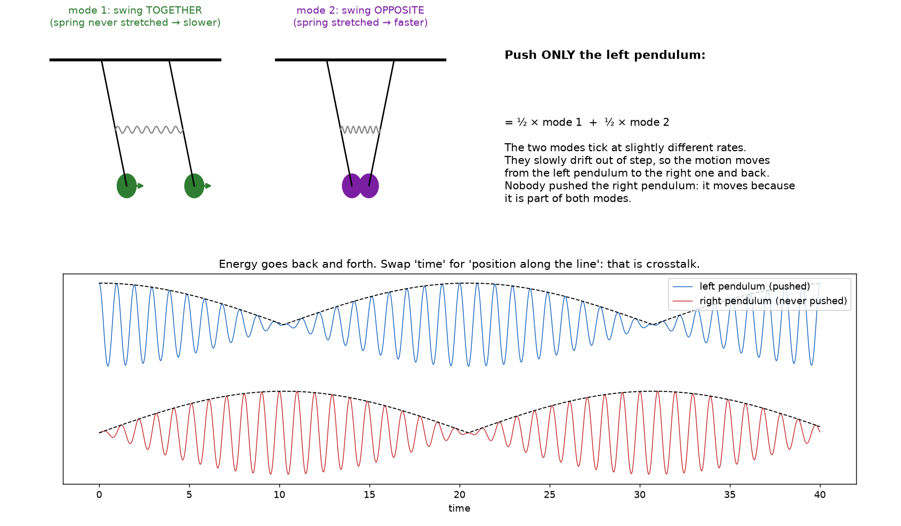

# Coupled lines, part A3: the modes

Follows `coupled_lines_A1_A2.md`, which ended with the eigenvalue problem
$(\mathbf{Z}\mathbf{Y} - \gamma^2\mathbf{1})\mathbf{V}_0 = 0$. This note says
what its solutions are, how to use them, and what they mean physically.

Checks: `docs/coupled/check_A3.py` (numpy, scipy).

---

## 1. The picture: two pendulums joined by a spring

Two identical pendulums hang side by side, joined by a weak spring.

- **Mode 1, swinging together.** The spring is never stretched, so it does
  nothing. Each pendulum ticks at its natural rate.
- **Mode 2, swinging opposite.** The spring is stretched and compressed every
  swing, which adds a restoring force. They tick slightly faster.

These are the only two motions that repeat unchanged. They exist because of
the structure (two pendulums plus a spring), whether or not anyone moves them.

**Push only the left pendulum.** Its starting state is half of mode 1 plus
half of mode 2. The two halves tick at slightly different rates and slowly
drift out of step. As they do, the motion moves from the left pendulum to the
right one, and later back. That is called **beating**. The right pendulum was
never pushed: it moves because it is part of both modes.

**The translation to our lines:**

| Pendulums | Coupled lines |
|---|---|
| two pendulums | two signal lines (A = aggressor, B = victim) |
| spring | mutual capacitance $C_m$ and mutual inductance $L_m$ |
| swinging together | even mode, voltages $(1, 1)$ |
| swinging opposite | odd mode, voltages $(1, -1)$ |
| ticking rate | propagation constant $\gamma = \alpha + j\beta$ (rate of phase change **per metre**) |
| time | position $z$ along the line |
| motion moving to the right pendulum | crosstalk: voltage appearing on line B |

**Where the analogy stops.** Pendulums beat in *time*; our modes beat in
*space*, along the line. And our lines lose energy (the pendulums here do
not), so a long enough line damps everything before the beat completes (§5).

---

## 2. The modes, formally

### 2.0 Why look for waves that keep their shape

*Picture: a chord on a piano.* A chord sounds complicated, but it is just a
sum of single notes, and each note behaves very simply. If we know how each
note behaves, we know the chord. The strategy here is the same: find the
"single notes" of the pair, the patterns that travel in the simplest possible
way, and build every other signal as a sum of them. This works because the
equations are linear: the sum of two solutions is a solution.

*"Shape" means the ratio $V_2/V_1$*, the pattern across the two lines. A
pattern keeps its shape if, at every position, both line voltages are
multiplied by the **same** number. Then their ratio never changes; only the
overall size and phase do.

*Why the exponential.* $\mathbf{V}(z) = \mathbf{V}_0\,e^{-\gamma z}$ multiplies
both entries of $\mathbf{V}_0$ by the same number $e^{-\gamma z}$ at each $z$,
so the ratio is the one of $\mathbf{V}_0$, everywhere. It is also the only
function whose derivative is proportional to itself,
$\frac{d}{dz}e^{-\gamma z} = -\gamma e^{-\gamma z}$, so derivatives turn into
multiplications and the differential equation becomes algebra. The single
line used exactly this: $V^+e^{-\gamma z}$.

*Derivation.* Substitute $\mathbf{V} = \mathbf{V}_0 e^{-\gamma z}$ into
$d^2\mathbf{V}/dz^2 = \mathbf{Z}\mathbf{Y}\mathbf{V}$. Differentiating twice
gives $(-\gamma)^2 = \gamma^2$:

$$
\gamma^2\,\mathbf{V}_0\,e^{-\gamma z} = \mathbf{Z}\mathbf{Y}\,\mathbf{V}_0\,e^{-\gamma z}.
$$

$e^{-\gamma z}$ is never zero, so divide by it:

$$
\mathbf{Z}\mathbf{Y}\,\mathbf{V}_0 = \gamma^2\,\mathbf{V}_0
\quad\Longleftrightarrow\quad
\left(\mathbf{Z}\mathbf{Y} - \gamma^2\,\mathbf{1}\right)\mathbf{V}_0 = 0 .
$$

($\mathbf{1}$ is the identity matrix, needed to subtract a number from a
matrix.) In words: applying $\mathbf{Z}\mathbf{Y}$ to the pattern must give
back **the same pattern**, only scaled by $\gamma^2$. Most vectors get turned
into a different direction by a matrix; the few that are only scaled are its
**eigenvectors**, and the scale factors are its **eigenvalues**.

*How many, and are they enough?* A non-zero $\mathbf{V}_0$ exists only if
$\det(\mathbf{Z}\mathbf{Y} - \gamma^2\mathbf{1}) = 0$. For
$`\mathbf{Z}\mathbf{Y} = \begin{pmatrix} a & b \\ b & a \end{pmatrix}`$ that is
$(a - \gamma^2)^2 - b^2 = 0$, so $\gamma^2 = a \pm b$: exactly two modes.
Each travels forwards and backwards ($e^{\mp\gamma z}$), giving four
solutions, which is the number of conditions a pair of lines has (one at each
of its four ends). So nothing is lost by looking only for shape-keeping waves:
every possible signal is a sum of them.

### 2.1 Modes are eigenvectors

From A2, a voltage pattern that travels along the line keeping its shape,
$\mathbf{V}(z) = \mathbf{V}_0\,e^{-\gamma z}$, must satisfy

$$
\mathbf{Z}\mathbf{Y}\,\mathbf{V}_0 = \gamma^2\,\mathbf{V}_0 .
$$

So $\mathbf{V}_0$ is an **eigenvector** of the $2\times2$ matrix
$\mathbf{Z}\mathbf{Y}$ and $\gamma^2$ its **eigenvalue**. A $2\times2$ matrix
has two of each: two modes, with propagation constants $\gamma_1$ and
$\gamma_2$, and voltage patterns $\mathbf{t}_1$ and $\mathbf{t}_2$. Collect
them in a matrix and a diagonal matrix:

$$
\mathbf{T}_V = \begin{pmatrix} \mathbf{t}_1 & \mathbf{t}_2 \end{pmatrix},
\qquad
\boldsymbol{\Gamma} = \begin{pmatrix} \gamma_1 & 0 \\ 0 & \gamma_2 \end{pmatrix},
\qquad
\mathbf{Z}\mathbf{Y}\,\mathbf{T}_V = \mathbf{T}_V\,\boldsymbol{\Gamma}^2 .
$$

### 2.2 Identical lines: the modes are always $(1,1)$ and $(1,-1)$

Here "identical" means that the two strips have the same width, the same
thickness and the same distance to ground, so the cross-section looks the same
when seen from line A or from line B.

**Step 1: which matrices.** The two matrices are the per-unit-length series
impedance $\mathbf Z$ and shunt admittance $\mathbf Y$ from A2:

$$
\mathbf Z = \begin{pmatrix} z_s & z_m \\ z_m & z_s \end{pmatrix},
\qquad
\mathbf Y = \begin{pmatrix} y_s & y_m \\ y_m & y_s \end{pmatrix},
$$

with $z_s = r + R_g + j\omega L_s$ (self), $z_m = R_g + j\omega L_m$ (mutual),
$y_s = G + j\omega(C_g + C_m)$ (self), $y_m = -j\omega C_m$ (mutual).

**Step 2: why they have the form $`\begin{pmatrix} a & b \\ b & a \end{pmatrix}`$.**

- Equal diagonals: line A seen alone is the same as line B seen alone, so the
  "self" entries are equal ($z_s$ for both, $y_s$ for both).
- Equal off-diagonals: what A does to B equals what B does to A (the same
  mutual inductance $L_m$, the same gap capacitance $C_m$, the same shared
  return $R_g$). This holds for any two lines, identical or not
  (reciprocity).

So each matrix has one number on the diagonal ($a$) and one off the diagonal
($b$).

**Step 3: the product keeps the form.** Multiply them out:

$$
\mathbf Z\mathbf Y =
\begin{pmatrix} z_s y_s + z_m y_m & z_s y_m + z_m y_s \\ z_m y_s + z_s y_m & z_m y_m + z_s y_s \end{pmatrix}
= \begin{pmatrix} a & b \\ b & a \end{pmatrix},
\qquad a = z_s y_s + z_m y_m,\quad b = z_s y_m + z_m y_s .
$$

The two diagonal entries are equal and the two off-diagonal entries are equal.
From now on $a$ and $b$ mean these two entries of $\mathbf{ZY}$.

**Step 4: why try $(1,1)$ and $(1,-1)$.** Read the matrix row by row. Row 1
says: the new value on line A is $a\times$(A's voltage) $+\ b\times$(B's
voltage). Row 2 says the same for line B, with the roles swapped. Each line
gets "$a$ times itself plus $b$ times the neighbour".

The machine treats the two lines the same way, so the patterns that survive
it unchanged must also treat the two lines fairly. There are only two fair
ways to share a voltage between two equal lines:

- the same on both: $(1,1)$;
- equal and opposite: $(1,-1)$.

Any other split, for example $(1, 0.5)$, favours one line. The machine then
mixes it into a different ratio, so it does not keep its shape.

**Step 5: check by multiplying.**

Pattern $(1,1)$: line A gets $a\cdot1 + b\cdot1 = a+b$. Line B gets
$b\cdot1 + a\cdot1 = a+b$. Both lines get the same factor, so the ratio stays
$1:1$:

$$
\begin{pmatrix} a & b \\ b & a \end{pmatrix}\begin{pmatrix} 1 \\ 1 \end{pmatrix} = (a + b)\begin{pmatrix} 1 \\ 1 \end{pmatrix}.
$$

Pattern $(1,-1)$: line A gets $a\cdot1 + b\cdot(-1) = a-b$. Line B gets
$b\cdot1 + a\cdot(-1) = -(a-b)$. Again both lines are multiplied by the same
factor, $a-b$, so the ratio stays $1:-1$:

$$
\begin{pmatrix} a & b \\ b & a \end{pmatrix}\begin{pmatrix} 1 \\ -1 \end{pmatrix} = (a - b)\begin{pmatrix} 1 \\ -1 \end{pmatrix}.
$$

Physically, in the even mode the neighbour pushes in the same direction as the
line itself, so the effects add ($a+b$). In the odd mode the neighbour pushes
the opposite way, so they subtract ($a-b$). Different factors mean different
propagation constants.

The eigenvectors are $(1,1)$ and $(1,-1)$ **whatever** $a$ and $b$ are, so at
every frequency, with any loss. That is the symmetry argument in one line:
whatever A does to B, B does to A. The eigenvalues are the $z_e y_e$ and
$z_o y_o$ of A2 §3.

$$
\mathbf{T}_V = \begin{pmatrix} 1 & 1 \\ 1 & -1 \end{pmatrix},
\qquad
\gamma_e = \sqrt{z_e y_e},\quad \gamma_o = \sqrt{z_o y_o}.
$$

### 2.3 Unequal lines: still two modes, but lopsided

If the lines differ (width, gap, or one line next to a ground edge), the
diagonal entries differ and $(1, \pm 1)$ are no longer eigenvectors. There are
still exactly two modes, but each has its own voltage ratio
$\mathbf{t} = (1, R)$ with $R \neq \pm 1$, found numerically.

Example from the check script (one line 25 % more inductive, 20 % less
capacitive): the two modes are $(1,\ 0.032)$ and $(1,\ -41)$. Each mode lives
almost entirely on one line. **Picture:** two pendulums of different lengths
joined by a weak spring hardly exchange energy, because they never stay in
step. Unequal lines therefore couple less.

---

## 3. The general solution

Each mode travels forwards and backwards like a single line. Adding the four
possibilities:

$$
\mathbf{V}(z) = \mathbf{T}_V \left[ e^{-\boldsymbol{\Gamma} z}\,\mathbf{a}^{+} + e^{+\boldsymbol{\Gamma} z}\,\mathbf{a}^{-} \right],
$$

where $\mathbf{a}^{+}$ and $\mathbf{a}^{-}$ hold the forward and backward
amplitudes of the two modes (four numbers, fixed later by the terminations in
A4). This is the single-line $V(z) = V^+e^{-\gamma z} + V^-e^{\gamma z}$, with
two modes instead of one.

### 3.1 Characteristic impedance matrix

#### The picture: how hard you must push

Think of a very long queue of people standing shoulder to shoulder, and you push
the first one. To get the queue moving at a given speed you have to push with
a certain force. That force does not depend on what happens at the far end of
the queue, because the far end has not felt anything yet. It depends only on
the queue itself: how heavy each person is and how springy the shoulders are.

A line works the same way. When a wave enters a long line, the source has to
charge each new piece of capacitance and push current through each new piece
of inductance. The ratio "voltage needed / current delivered" is set by the
line alone. That ratio is the **characteristic impedance** $Z_c$.

It looks like Ohm's law, and it is used like Ohm's law, but there is no
resistor: no energy is turned into heat. The energy is stored in the line and
carried away by the wave. The source cannot tell the difference between a
long line and a resistor of value $Z_c$, until the first reflection comes back.

#### Where $-dV/dz = Z\,I$ comes from (A2 §2.2)

Take a short piece $dz$ of a single line. Its series branch has resistance
$R\,dz$ and inductance $L\,dz$, i.e. impedance $Z\,dz$ with
$Z = R + j\omega L$ (per metre). The current $I$ flows through it, so the
voltage drops across it by Ohm's law:

$$
V(z) - V(z+dz) = Z\,dz\;I .
$$

Divide by $dz$:

$$
-\frac{dV}{dz} = Z\,I .
$$

In words: **the voltage falls along the line at a rate equal to the series
impedance per metre times the current.** The minus sign means "falls" in the
direction the current flows. For the pair, line A's voltage falls because of
its own current (self term) and its neighbour's current (mutual term); writing
both lines together gives the same equation with $2\times2$ matrices,
$-d\mathbf V/dz = \mathbf Z\,\mathbf I$ (A2 §2.2).

#### Single line: $Z_c$ in two lines of algebra

A forward wave has $V(z) = V^+ e^{-\gamma z}$ and $I(z) = I^+ e^{-\gamma z}$.
Its derivative is $dV/dz = -\gamma V$. Put that into $-dV/dz = Z\,I$:

$$
\gamma\,V^+ = Z\,I^+
\qquad\Longrightarrow\qquad
Z_c = \frac{V^+}{I^+} = \frac{Z}{\gamma} = \sqrt{\frac{Z}{Y}}
\quad\left(\text{lossless: } \sqrt{L/C}\right).
$$

A backward wave gives $V^- = -Z_c I^-$: same ratio, but its current flows
the other way.

#### Pair of identical lines: mode by mode

Each mode is a single line on its own, so each has its own characteristic
impedance, $Z_e$ for the even mode and $Z_o$ for the odd mode (per line:
the voltage on one strip divided by the current in that strip).

Now push a forward current into line A only, $\mathbf I = (1, 0)$ A, and ask
which voltages appear. Split the current into modes and treat each mode as a
single line:

$$
\begin{pmatrix} 1 \\ 0 \end{pmatrix}
= \tfrac12\begin{pmatrix} 1 \\ 1 \end{pmatrix} + \tfrac12\begin{pmatrix} 1 \\ -1 \end{pmatrix}
\quad\Longrightarrow\quad
\mathbf V = \tfrac12 Z_e\begin{pmatrix} 1 \\ 1 \end{pmatrix} + \tfrac12 Z_o\begin{pmatrix} 1 \\ -1 \end{pmatrix}
= \begin{pmatrix} \tfrac12(Z_e + Z_o) \\ \tfrac12(Z_e - Z_o) \end{pmatrix}.
$$

So 1 A on line A produces $\tfrac12(Z_e+Z_o)$ volts on line A and
$\tfrac12(Z_e-Z_o)$ volts on line B. Doing the same with $(0, 1)$ gives the
mirror image. Collecting both into a table gives the characteristic impedance
matrix, the matrix version of $V = Z_c I$:

$$
\mathbf V = \mathbf Z_c\,\mathbf I,
\qquad
\mathbf{Z}_c = \frac12 \begin{pmatrix} Z_e + Z_o & Z_e - Z_o \\ Z_e - Z_o & Z_e + Z_o \end{pmatrix}.
$$

#### General formula (any two lines)

The recipe is the same: translate the current into modes, apply each mode's
own impedance, translate back. In matrix form, the forward wave is

$$
\mathbf V(z) = \mathbf T_V\, e^{-\boldsymbol\Gamma z}\,\mathbf a^{+},
\qquad
e^{-\boldsymbol\Gamma z} = \begin{pmatrix} e^{-\gamma_1 z} & 0 \\ 0 & e^{-\gamma_2 z} \end{pmatrix},
$$

read right to left: $\mathbf a^{+}$ holds the starting amount of each mode,
$e^{-\boldsymbol\Gamma z}$ makes each amount travel with its own $\gamma$,
and $\mathbf T_V$ translates the amounts into line voltages (§2.1). Taking
the derivative and using $-d\mathbf V/dz = \mathbf Z\,\mathbf I$ exactly as
for the single line gives

$$
\mathbf{Z}_c = \mathbf{T}_V\,\boldsymbol{\Gamma}^{-1}\,\mathbf{T}_V^{-1}\,\mathbf{Z},
$$

the matrix version of $Z_c = Z/\gamma$. For identical lines it reduces to the
table above (checked numerically: both give
$36.651 - 0.012j\ \Omega$ on the diagonal and $0.044 - 0.003j\ \Omega$ off it
at 30 GHz).

#### What the entries mean

- **Diagonal** $\tfrac12(Z_e + Z_o)$: the impedance one line shows when the
  other carries no wave. With our numbers, $36.66\ \Omega$, essentially the
  single-line $Z_c$.
- **Off-diagonal** $\tfrac12(Z_e - Z_o)$: the coupling, $0.044\ \Omega$. In
  words, a forward current on line A comes with a small forward voltage on
  line B.

**Consequence for terminations (picture: a door that fits only one key).** A
termination absorbs all modes only if it equals $\mathbf{Z}_c$, off-diagonal
included. Two separate resistors to ground (each line ending in its own load)
can match the diagonal but not the off-diagonal term. So at a real end, one
mode reflects slightly differently from the other, and part of an even wave
comes back as odd, and vice versa: **mode conversion**. With
$Z_e - Z_o \approx 0.09\ \Omega$ it is tiny, but A4 includes it exactly.

### 3.2 Currents

The current patterns of the modes are the eigenvectors of
$\mathbf{Y}\mathbf{Z}$ (note the order). For reciprocal lines ($\mathbf{Z}$
and $\mathbf{Y}$ symmetric) they follow from the voltage patterns:
$\mathbf{T}_I = (\mathbf{T}_V^{-1})^{\mathsf T}$. For identical lines they are
again $(1,1)$ and $(1,-1)$ (up to scale).

---

## 4. Launching on one line only

At $z = 0$ the drive is $\mathbf{V} = (1, 0)$. Its modal content is
$\mathbf{T}_V^{-1}(1,0)^{\mathsf T}$:

$$
\begin{pmatrix} 1 \\ 0 \end{pmatrix} = \tfrac12\begin{pmatrix} 1 \\ 1 \end{pmatrix} + \tfrac12\begin{pmatrix} 1 \\ -1 \end{pmatrix}.
$$

Each half travels with its own $\gamma$. With matched ends (no backward
waves):

$$
V_A(z) = \tfrac12\left(e^{-\gamma_e z} + e^{-\gamma_o z}\right),
\qquad
V_B(z) = \tfrac12\left(e^{-\gamma_e z} - e^{-\gamma_o z}\right).
$$

Write $\bar\gamma = \tfrac12(\gamma_e + \gamma_o)$ and
$\delta = \tfrac12(\gamma_o - \gamma_e)$. Then

$$
V_A(z) = e^{-\bar\gamma z}\cosh(\delta z),
\qquad
V_B(z) = e^{-\bar\gamma z}\sinh(\delta z).
$$

For a lossless pair $\delta = j\,\Delta\beta/2$ and these are
$\cos(\Delta\beta z/2)$ and $j\sin(\Delta\beta z/2)$: the pendulum beat, in
space. The victim-to-aggressor ratio is

$$
\left|\frac{V_B}{V_A}\right| = \left|\tan\frac{\Delta\beta\,z}{2}\right| \approx \frac{|\Delta\beta|\,z}{2}
\quad\text{for short lines,}
$$

the linear growth of far-end crosstalk with length from A1 (the truck and the
balls), now derived.

---

## 5. Numbers for our pair

With the first-look values from the 1 mm file ($n_o - n_e \approx 2\times10^{-4}$):

| $f$ | Length for complete transfer to B (half a beat) | $\lvert V_B/V_A\rvert$ at 14 mm |
|---|---|---|
| 10 GHz | 75 m | $2.9\times10^{-4}$ ($-71$ dB) |
| 30 GHz | 29 m | $7.5\times10^{-4}$ ($-62$ dB) |

The beat is **tens of metres** long; our electrodes are millimetres. We only
ever see the very first, straight part of the beat, which is why the far-end
crosstalk grows in proportion to length. Loss (2–4 dB/cm) kills both signals
long before the beat could complete.

Unvalidated: one length, CST port regions included (see A1–A2 §4).

---

## 6. Checks (`check_A3.py`)

- Identical lines: the numerical eigenvectors of $\mathbf{Z}\mathbf{Y}$ are
  $(1,1)$ and $(1,-1)$ to $10^{-12}$; the current eigenvectors equal
  $(\mathbf{T}_V^{-1})^{\mathsf T}$.
- $\mathbf{Z}_c$ from the general formula has diagonal $36.662 - 1.016j\ \Omega$
  and off-diagonal $0.044\ \Omega$, giving back $Z_e$ and $Z_o$.
- Forward waves only: launch $\mathbf{I} = \mathbf{Z}_c^{-1}\mathbf{V}$ and
  integrate the telegrapher's equations over 14 mm with no modes assumed.
  $\mathbf{V} = \mathbf{Z}_c\mathbf{I}$ still holds to $10^{-15}$, for
  identical and for unequal lines.
- Unequal lines: modes $(1,\ 0.032)$ and $(1,\ -41)$.

## 7. Exercises

1. Show that $(1,1)$ and $(1,-1)$ are eigenvectors of any matrix
   $`\begin{pmatrix} a & b \\ b & a \end{pmatrix}`$, and find the eigenvalues.
2. Derive $\mathbf{Z}_c$ for identical lines from
   $\mathbf{Z}_c = \mathbf{T}_V\boldsymbol{\Gamma}^{-1}\mathbf{T}_V^{-1}\mathbf{Z}$.
3. Derive $V_A = e^{-\bar\gamma z}\cosh\delta z$ and
   $V_B = e^{-\bar\gamma z}\sinh\delta z$ from the two exponentials.
4. *Picture.* Explain with the pendulums why unequal lines couple less.
5. *Predict.* If $n_o > n_e$, does the victim's far-end voltage lead or lag
   the aggressor's by 90°? (Use §4.)
